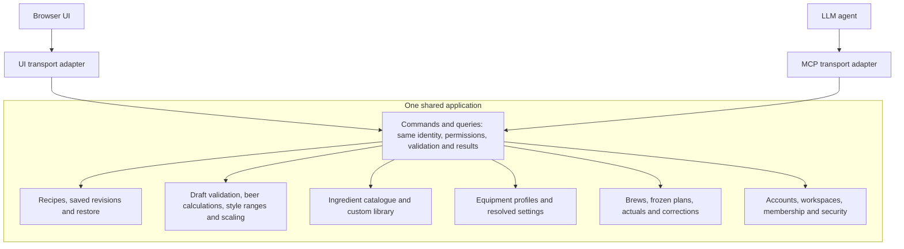
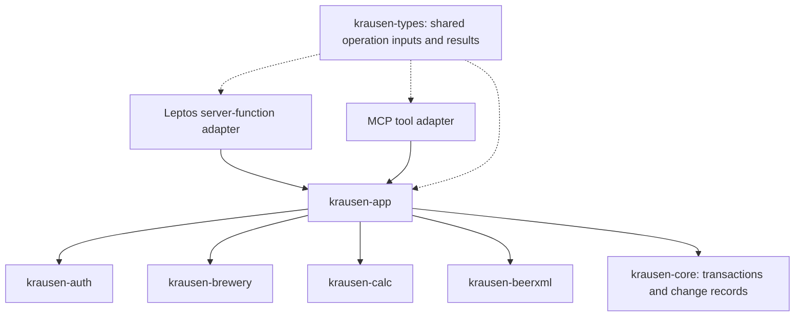

# Shared application architecture

Status: KRA-1 design draft, recording confirmed product contracts and a proposed
technical architecture. The draft received independent review for continued
design; KRA-5 combined adoption remains pending. This document does not claim
that the target services or MCP capabilities are implemented.

Read this alongside [the design system](../DESIGN.md), the documentation index,
and the KRA-2 data-model and KRA-3 calculation deliverables. Where older coding
guidance assumes UI-owned business rules, separate change-log writes or mandatory
WebSocket broadcasts, reconcile it with this proposal during KRA-5.

## Confirmed product contracts

- Krausen is AGPL software with hosted and self-hosted deployments. Each
  installation authenticates its own accounts. Follow the existing Kyomi
  account/session and browser authorization model closely, adapting reusable
  Krausen foundations.
- UI and MCP are alternate interfaces to the same application. They use the
  same user permissions, validation, business rules and outcomes. There are no
  MCP-specific roles, capability grants or product feature restrictions.
- Workspaces own recipes and brews. All members may create and edit brewing
  content; admins/owners manage membership and workspace settings. Record
  creator/editor provenance. A personal collection is a one-member workspace.
- Editing uses independent drafts and optimistic revision checks. Saves are
  explicit. Preserve drafts on conflicts; there is no live collaborative editor.
- Saved recipe revisions form linear history. Restoring creates a new current
  revision. A brew permanently pins its chosen saved revision and freezes its
  effective equipment/process inputs, original targets and calculation context.
  Later recipe/profile edits cannot rewrite historical brews.
- Actual measurements, corrections, notes and formulation deviations belong to
  the brew. Applying findings back to a recipe is an explicit new revision.

## Application architecture

UI and MCP are two interfaces to one application. Every application capability,
including calculation previews, is exposed through the same shared operations.
Transport and presentation are the only interface-specific layers.



Arrows describe intended dependencies or calls, not separate deployed services.
Both adapters invoke the same application calculation operation. Live recipe
previews, including beer targets and style comparisons, are shared capabilities
available through UI and MCP with the same inputs, workspace policy, equipment
resolution, diagnostics and results. The UI refreshes that preview as the draft
changes; an agent invokes the equivalent query. Neither action saves a revision.

For example, the logical `CalculateRecipeDraft` query accepts an unsaved native
draft and explicit calculation context, resolves authorized equipment/catalogue
references, validates and calculates, then returns targets, assumptions,
field diagnostics, style comparisons and engine/context versions. Both adapters
call that operation. Save and start-brew also use the shared resolution and
calculation pipeline, rechecking context before committing. Exact wire names
remain an implementation detail.

The current design prototype calls a local WASM bridge because it has no
application backend. That is a prototype limitation, not the production
application architecture or a UI-exclusive capability. The production baseline
uses the shared application query for previews; no separate browser calculation
path is required.

## Supporting code boundaries

The application diagram above defines capability access. The dependency diagram
below maps its implementation to Rust crates; it does not add another client
path. Keep a modular monolith and introduce a small `krausen-app` crate for
shared commands, queries and policy orchestration. Reuse existing lower-level
modules; no generic command bus, repository framework or separate service
deployment is required.



| Boundary | Responsibility |
| --- | --- |
| UI/server-function and MCP adapters | Decode input, verify transport credentials, normalize trusted principal, invoke shared operation, map result envelope |
| `krausen-app` | Resolve effective workspace, authorize, validate, orchestrate workflows and transactional mutations |
| `krausen-auth` | Reusable account, session, credential and membership primitives; shared security workflows below both adapters |
| `krausen-brewery` | Brewing persistence and domain workflows, including revision and snapshot storage |
| `krausen-calc` | Framework/database-independent deterministic calculations; no dependency on app or UI |
| `krausen-beerxml` | Import/export parsing and representation; preserve explicit conversion warnings |
| `krausen-types` | Serializable WASM-safe operation contracts; no transport/server framework dependencies |
| `krausen-core` | Existing configuration/database/error infrastructure, with transaction-aware access refined before adoption |

`krausen-app` public contracts expose no Leptos, Axum or MCP types. Domain
validation, import/derivation orchestration, role transitions and security rules
must live below both adapters. Wrapping existing CRUD alone would bypass rules
currently held in UI server functions.

## Authentication and authorization

Adapters establish a trusted principal from verified credentials. A supplied
user ID or workspace ID is data, never proof of authority. Shared operations
check current account status, membership and operation policy; membership lookup
errors fail closed. Recheck permission-sensitive state at the mutation boundary.

Each call has one explicit effective workspace. Browser workspace selection must
not silently retarget an unrelated concurrent MCP connection. Selection grants
no entitlement; credential binding and current membership still apply. Final
workspace/credential switching mechanics remain a technical refinement.

Adapt Kyomi's discovery, client registration, browser login/authorization, PKCE,
token/refresh and authenticated-handler patterns. Do not copy commercial feature
gates or a separate agent permission system. Connection authentication,
credential audience validation and revocation are credential lifecycle concerns;
application permissions remain identical to those of the same user in the UI.

Revoking a connection must prevent its next protected request, including requests
using an outstanding access token. Revoking only a refresh family is insufficient.
Removing workspace membership blocks subsequent operations through either
interface. Revoking one connection does not remove permissions from other
sessions belonging to the same user.

Account entry is the bootstrap for MCP. An unauthenticated agent cannot grant
itself an identity through authenticated tools. Browser/device/email proof
remains necessary wherever the shared workflow requires it. Expose appropriate
start/status/complete or pending-interaction outcomes so both interfaces support
the same workflow; pending proof is never reported as success. Keep credentials
out of ordinary logs and change payloads.

## Capability matrix

These are logical operation families, not final tool names or a fixed tool count.
Every UI-backed application read or mutation must have equivalent MCP coverage,
with the same shared operation, policy, validation, side effects and result.

| Family | Required shared operations | Shared policy |
| --- | --- | --- |
| Identity/context | Get current user/context; list and select workspaces | Authenticated identity and current membership |
| Recipes | List/search/filter/page; get inputs/assumptions; create/update/duplicate/delete; retrieve history and restore | Member; revision checks for mutable state |
| Formulation | Validate unsaved draft; calculate targets, assumptions, diagnostics and style comparisons; preview/apply batch scaling | Same shared application operations and resolved context for UI/MCP; preview is read-only; authoritative validation on save/start |
| Interchange | Preview/commit BeerXML import; export recipe/process summary | Membership for stored data; structured preservation warnings |
| Ingredients | Search/get catalogue entries; create/edit custom entries; resolve specifications | Workspace policy; resolved saved recipe inputs remain stable |
| Equipment | List/get/create/edit/delete profiles; select/resolve effective settings | Member; future previews use current settings, historical snapshots remain fixed |
| Brews | Start/list/get; allowed lifecycle transitions; retrieve immutable inputs/targets | Member; atomic source-revision and snapshot checks |
| Observations | Record/list readings and notes; correct readings; inspect correction history | Member; retain original evidence and provenance |
| History/comparison | List recipe brews; retrieve planned snapshots and target/actual comparisons; explicitly apply brew findings | Membership; recipe/profile changes remain explicit |
| Profile/appearance | Get/update name/theme; list pending invitations; accept/decline | User owns profile; invitation intended-recipient checks |
| Workspace/team | Get/update settings/name; list/invite/remove members; change roles; list/cancel invitations | Ordinary member/context reads for members; admin/owner management guards |
| Ownership | Start/list/get/cancel/accept/decline transfers | Shared owner, intended-recipient and confirmation rules |
| Sessions/connections | List/revoke; logout current/all sessions | User/session ownership; effective revocation on subsequent protected requests |
| Security | Password status/set/change; TOTP status/setup/enable/disable; passkey list/register/rename/delete | Same proof, role and last-auth-method protections |
| Account entry/recovery | Auth configuration; signup/verification/resend; password/passkey/Google login; recovery; terms acceptance | Shared supported workflows and real verification requirements |

This includes existing auth/context/profile/sidebar/workspace/team/ownership/
security/onboarding/recipe families and planned brewing capabilities. Sensitive
invitation, transfer and session reads require explicit visibility rules shared
by both interfaces; grouping them under administration must not accidentally
make all ordinary member reads admin-only.

Focus, opening a menu, a browser print dialog and local undo are presentation
behaviors. Their underlying persisted changes or export capabilities remain
available through MCP. Browser recovery drafts are local presentation state;
persisted server drafts, if introduced later, would be shared operations too.

## Common execution and persistence contract

1. Authenticate and normalize trusted principal/session context.
2. Resolve the explicit effective workspace and current membership.
3. Apply shared policy and input validation. Derivation/validation previews have
   no persistence side effects. Queries use stable identifiers, explicit missing
   data and bounded pagination.
4. Require expected revisions for mutable entity updates. If state changed,
   return a typed conflict and commit nothing; preserve the caller's draft.
   Brew start also checks the selected recipe and effective profile context.
5. Give non-idempotent creates/imports/brew starts/observation writes a scoped
   request identity. Bind it to principal, workspace, operation and payload.
   Repeating the same request returns its recorded result; conflicting reuse
   fails. Client-provided actor IDs cannot establish retry ownership.
6. Commit the entity mutation, revision, required retry result and required
   durable change/audit entry on the same transaction/connection. Rollback leaves
   none committed. This must work for supported SQLite and PostgreSQL backends.
7. Publish optional invalidation only after commit. Delivery failure cannot
   undo a committed result or cause a retry to create duplicate data. Recover
   the committed operation through its recorded result.

Existing pool-only query helpers and separate sync-log writes must be reconciled
with this transaction boundary. Retained helpers need a transaction-capable
interface; exact APIs and transaction isolation/race handling are pending
implementation refinement. Change notifications do not substitute for recipe
revision history or measurement correction evidence.

## Refetch and draft safety

Refetch on navigation/focus and after writes. Existing invalidations may prompt
clean views to reload. A dirty editor retains its local draft and can show a
remote-change notice; it must not replace edits with fetched data. An expected
revision remains the correctness backstop if notifications are absent or late.

No new durable push/replay/subscription system, CRDT or remote-keystroke protocol
is required for UI/MCP parity. Reconnecting clients can refetch current state.
Explicit Save, Save/Discard/Stay navigation and browser draft recovery follow
the approved design specification.

## Typed results and examples

Shared outcomes distinguish validation/incomplete input, unauthenticated,
forbidden, absent, conflict, pending interaction, retryable/unavailable and
internal errors. Transport adapters map these outcomes without replacing them
with transport-specific business rules. Do not expose secrets or disclose
another workspace's existence through verbose failures.

Illustrative shapes below are not final wire schemas:

```text
UpdateRecipe(recipe_id, expected_revision=7, draft)
  -> Saved(recipe_id, revision=8)
  -> Conflict(entity_id, expected_revision=7, current_revision=8)

StartBrew(recipe_revision, expected_equipment_revision, request_id)
  -> Started(brew_id, frozen_inputs, original_targets)
  -> ContextConflict(current_recipe_revision, current_equipment_revision)

BeginPasskeyRegistration(...)
  -> PendingInteraction(interaction_id, next_action="open_browser", url, expires_at)

ProtectedOperation(...)
  -> Unauthenticated(reason="connection_revoked")
```

A second recipe save based on revision 7 cannot overwrite revision 8. A repeated
brew-start request with the same scoped identity returns the first committed
brew. A role change enforces owner/self-demotion/target-membership rules through
either interface. Passkey registration is incomplete until its real ceremony
succeeds. These outcomes must be exercised through both adapters during
implementation acceptance.

## Existing implementation and gaps

The repository contains reusable account/session/workspace services, OAuth
client/token associations, brewing recipe persistence, calculation and BeerXML
libraries, and a WASM-safe types crate. UI server functions currently contain
some business/security and recipe import/derive orchestration.

`apps/server/src/routes/oauth.rs` has empty route builders. The MCP handler is
scaffolding with anonymous sessions and a placeholder tool flow. Its declared
protocol version does not establish client/protocol conformance. `krausen-app`,
the complete shared operation catalogue, authenticated MCP access and production
revision/snapshot/measurement contracts are target work. The browser-local
design prototype does not implement these backend guarantees.

## Remaining refinements and adoption

- Confirm supported MCP specification/SDK versions and client compatibility
  against official requirements when implementing; no conformance claim follows
  from scaffolding or reuse alone.
- Finalize installation-local credential/workspace switching and effective
  access-token revocation checks, using the Kyomi pattern deliberately.
- Specify transaction-aware database helpers, mutation race checks, retry-result
  retention and request-identity/error schemas.
- Finalize operation/tool naming, bounded pagination schemas and sensitive-read
  visibility rules while preserving complete UI/MCP capability coverage.
- KRA-2 defines native revision/snapshot schemas, measurements/corrections,
  deletion rules and actual brew amendments. KRA-3 defines calculation,
  scaling and interchange semantics. KRA-4 provides visual/interaction guidance.
- KRA-5 reconciles those documents and older coding guidance, independently
  reviews material changes and adopts the combined architecture before
  downstream implementation tickets proceed.

These refinements must preserve identical application permissions, immutable
historical brew inputs and simple revision/refetch concurrency.
