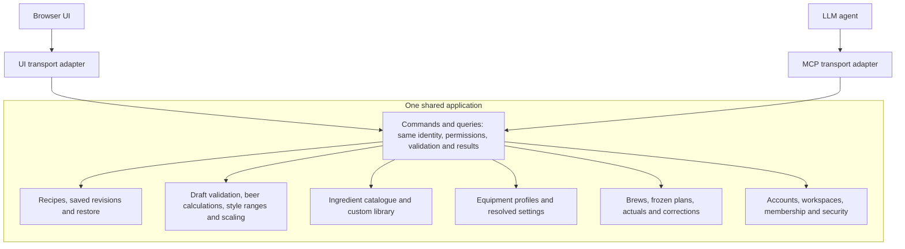
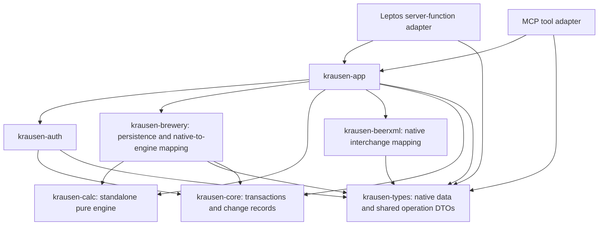

# Shared application architecture

Status: adopted KRA-5 implementation contract, 2026-10-31. Independent
changed-contract approval is recorded in [the adoption record](ADOPTION.md).
This specifies target behavior; it does not claim services are already implemented.

Read with [data model](DATA_MODEL.md), [calculations](CALCULATIONS.md),
[design system](../DESIGN.md) and [coding standards](CODING_STANDARDS.md).
These contracts supersede conflicting starter/historical instructions.

## Confirmed product contracts

- Krausen is AGPL software with hosted and self-hosted deployments. Each
  installation authenticates its own accounts. Follow the existing Kyomi
  account/session and browser authorization model closely, adapting reusable
  Krausen foundations.
- UI and MCP are alternate interfaces to the same application. They use the
  same user permissions, validation, business rules and outcomes. There are no
  MCP-specific roles, capability grants or product feature restrictions.
- Workspaces own recipes and brews. All members may create and edit brewing
  content; admins/owners manage membership and workspace settings. Record
  creator/editor provenance. A personal collection is a one-member workspace.
- Editing uses independent drafts and optimistic revision checks. Saves are
  explicit. Preserve drafts on conflicts; there is no live collaborative editor.
- Saved recipe revisions form linear history. Restoring creates a new current
  revision. A brew permanently pins its chosen saved revision and freezes its
  effective equipment/process inputs, original targets and calculation context.
  Later recipe/profile edits cannot rewrite historical brews.
- Actual measurements, corrections, notes and formulation deviations belong to
  the brew. Applying findings back to a recipe is an explicit new revision.

## Application architecture

UI and MCP are two interfaces to one application. Every application capability,
including calculation previews, is exposed through the same shared operations.
Transport and presentation are the only interface-specific layers.



Arrows describe intended dependencies or calls, not separate deployed services.
Both adapters invoke the same application calculation operation. Live recipe
previews, including beer targets and style comparisons, are shared capabilities
available through UI and MCP with the same inputs, workspace policy, equipment
resolution, diagnostics and results. The UI refreshes that preview as the draft
changes; an agent invokes the equivalent query. Neither action saves a revision.

For example, the logical `CalculateRecipeDraft` query accepts an unsaved native
draft and explicit calculation context, resolves authorized equipment/catalogue
references, validates and calculates, then returns targets, assumptions,
field diagnostics, style comparisons and engine/context versions. Both adapters
call that operation. Save and start-brew also use the shared resolution and
calculation pipeline, rechecking context before committing. Operation contracts below are normative; transport wire names are bound to them
in one versioned registry rather than defining policy in either adapter.

The current design prototype calls a local WASM bridge because it has no
application backend. That is a prototype limitation, not the production
application architecture or a UI-exclusive capability. The production baseline
uses the shared application query for previews; no separate browser calculation
path is required.

## Supporting code boundaries

The application diagram above defines capability access. The dependency diagram
below maps its implementation to Rust crates; every arrow points from a consumer
to a dependency. It does not add another client path. Keep a modular monolith and introduce a small `krausen-app` crate for
shared commands, queries and policy orchestration. Reuse existing lower-level
modules; no generic command bus, repository framework or separate service
deployment is required.



| Boundary | Responsibility |
| --- | --- |
| UI/server-function and MCP adapters | Decode input, verify transport credentials, normalize trusted principal, invoke shared operation, map result envelope |
| `krausen-app` | Resolve effective workspace, authorize, validate, orchestrate workflows and transactional mutations |
| `krausen-auth` | Reusable account, session, credential and membership primitives; shared security workflows below both adapters |
| `krausen-brewery` | Transaction-participating persistence helpers and native-to-engine projections; no policy authority or commit ownership |
| `krausen-calc` | Framework/database-independent deterministic calculations; no dependency on app or UI |
| `krausen-beerxml` | Format parsing/serialization and `native` mappings between BeerXML and canonical native types; no database or transport |
| `krausen-types` | `brewery` owns versioned native recipe/equipment/brew/measurement documents; also shared operation DTOs; serde-only, no policy or database |
| `krausen-core` | Database connection/transaction primitives, configuration and infrastructure errors; executable migrations belong to the server composition root |

`krausen-app` public contracts expose no Leptos, Axum or MCP types. Domain
validation, import/derivation orchestration, role transitions and security rules
must live below both adapters. Wrapping existing CRUD alone would bypass rules
currently held in UI server functions.

### Model, mapping and delivery ownership

`krausen-types::brewery` owns versioned canonical data. A calculation input or
BeerXML record is a projection, never another editable source of truth.
`krausen-brewery::mapping::calculation` converts resolved native values into
standalone `krausen-calc` inputs. `krausen-beerxml::native` owns both interchange
mappings and preservation diagnostics. `krausen-app::formulation` authorizes and
resolves references, calls those pure mappings and the engine, assembles preview
context/style comparisons, and orchestrates persistence. The browser and MCP
adapter consume shared DTOs and never reimplement these steps.

Calculation and native-model dependencies stay acyclic: types has only data
serialization dependencies; calc has no dependency on any Krausen crate; XML may
depend on types and calc; brewery may depend on types/core/calc/XML; app depends
on those lower libraries; adapters depend on app/types. Presentation components
never import persistence helpers. Auth primitives must not import app or brewery.

Existing MCP/SSE/WebSocket managers in auth are transport/infrastructure code,
not a brewing service requirement. KRA-7 removes manager arguments from shared
mutations; KRA-10 moves or wraps delivery at the server adapter boundary. They
may remain in their legacy location during migration, but new domain code must
not depend on them. Only committed outcomes leave the transaction. B8's migration
extraction is assigned to KRA-7; it is not a prerequisite to initial schema work.

## Authentication and authorization

Adapters establish a trusted principal from verified credentials. A supplied
user ID or workspace ID is data, never proof of authority. Shared operations
check current account status, membership and operation policy; membership lookup
errors fail closed. Recheck permission-sensitive state at the mutation boundary.

Each call has one explicit effective workspace. Browser workspace selection must
not silently retarget an unrelated concurrent MCP connection. Selection grants
no entitlement; credential binding and current membership still apply. The browser may remember a last-workspace preference, but every shared call
includes an explicit workspace. MCP arguments use that same workspace field;
a browser preference update cannot alter another request or connection. No
workspace privilege is embedded in the remembered selection.

Adapt Kyomi's discovery, client registration, browser login/authorization, PKCE,
token/refresh and authenticated-handler patterns. Do not copy commercial feature
gates or a separate agent permission system. Connection authentication,
credential audience validation and revocation are credential lifecycle concerns;
application permissions remain identical to those of the same user in the UI.

Revoking a connection must prevent its next protected request, including requests
using an outstanding access token. Revoking only a refresh family is insufficient.
Removing workspace membership blocks subsequent operations through either
interface. Revoking one connection does not remove permissions from other
sessions belonging to the same user.

Account entry is the bootstrap for MCP. An unauthenticated agent cannot grant
itself an identity through authenticated tools. Browser/device/email proof
remains necessary wherever the shared workflow requires it. Expose appropriate
start/status/complete or pending-interaction outcomes so both interfaces support
the same workflow; pending proof is never reported as success. Keep credentials
out of ordinary logs and change payloads.

### Installation and credential contract

Both hosted and self-hosted installations require authenticated accounts; a
one-member workspace is not an anonymous application mode. Retire the starter's
login-free personal mode for protected operations. Without SMTP, installation
setup creates the first owner only through a local operator setup command or
single-use setup secret; once initialized, ordinary account/role rules apply.
No separate subscription or agent permission model is introduced.

Browser sessions and MCP connections have durable credential records linked to
one account. Every protected call verifies issuer, audience, expiry and durable
credential/account revocation; current workspace membership is checked in shared
operations. Authentication failures and datastore failures fail closed. Positive
membership/revocation caches cannot extend access past a committed revocation.
Workspace removal revokes that membership, not every credential the account owns.

Reuse Kyomi's installation-local browser login/authorization, PKCE and refresh
patterns. Use exact registered redirect matching, state, S256 PKCE and one-time
codes bound to client, user, redirect and resource audience. Refresh rotates a
hashed token family atomically; replay revokes the family. Ordinary operations
never return access/refresh tokens in retry records, logs or change events.
Pending proof records bind account, initiating credential/session, action,
challenge, expiry and target. Completion atomically verifies and consumes the
proof once; URL possession alone cannot complete another principal's action.
Authorization pages require the same real identity proofs as UI entry.

Sensitive visibility is shared policy: ordinary workspace members may read
membership/context; admins/owners manage workspace settings and membership;
owners alone transfer ownership. Session/credential/security details are visible
to their owning account. Invitation management is admin/owner-only; an intended
recipient can inspect/accept/decline their own invitation. Transfers are visible
to the current owner and intended recipient. Role changes cannot remove the last
owner; transfer updates owner and role state atomically. Removing or downgrading
another owner follows that ownership workflow, not an unrestricted role update.

### MCP transport choice

KRA-10 uses the official Rust `rmcp` SDK, initially pinning the released 3.6.0
baseline, not copying the scaffold protocol implementation. Target Streamable
HTTP revision `2026-07-28`; also accept negotiated `2025-11-25` for older clients.
Transport versions map to the same operation registry, identity and results.
Do not reinterpret legacy session IDs as account authentication. Client acceptance
uses the official SDK test client at both revisions plus real configured clients
when available; record versions actually tested rather than claiming universal
client support. Unsupported versions fail explicitly.

The newer revision has self-contained requests and no protocol-level session;
legacy session/stream state belongs only to its adapter. Reconnect/refetch plus
application request identity ensures correctness without durable notification
replay. Adopt installation-local OAuth discovery and protected-resource metadata;
validate resource audience and Origin, and keep callback/client metadata fetches
bounded and protected against private-network SSRF. SDK updates and additional
clients are mechanical implementation work under this contract, not a new
business permission design.

Protocol sources checked 2026-10-31:
[transport](https://modelcontextprotocol.io/specification/2026-07-28/basic/transports/streamable-http),
[authorization](https://modelcontextprotocol.io/specification/2026-07-28/basic/authorization),
[official Rust SDK](https://github.com/modelcontextprotocol/rust-sdk),
[SDK release](https://github.com/modelcontextprotocol/rust-sdk/releases/tag/rmcp-v3.6.0).
Kyomi's older handshake is an authentication-pattern reference, not the protocol
compatibility oracle.

## Capability matrix

These are logical operation families, not final tool names or a fixed tool count.
Every UI-backed application read or mutation must have equivalent MCP coverage,
with the same shared operation, policy, validation, side effects and result.

| Family | Required shared operations | Shared policy |
| --- | --- | --- |
| Identity/context | Get current user/context; list and select workspaces | Authenticated identity and current membership |
| Recipes | List/search/filter/page; get inputs/assumptions; create/update/duplicate/delete; retrieve history and restore | Member; revision checks for mutable state |
| Formulation | Validate unsaved draft; calculate targets, assumptions, diagnostics and style comparisons; preview/apply batch scaling | Same shared application operations and resolved context for UI/MCP; preview is read-only; authoritative validation on save/start |
| Interchange | Preview/commit BeerXML import; export recipe/process summary | Membership for stored data; structured preservation warnings |
| Ingredients | Search/get catalogue entries; create/edit custom entries; resolve specifications | Workspace policy; resolved saved recipe inputs remain stable |
| Equipment | List/get/create/edit/delete profiles; select/resolve effective settings | Member; future previews use current settings, historical snapshots remain fixed |
| Brews | Start/list/get; allowed lifecycle transitions; retrieve immutable inputs/targets | Member; atomic source-revision and snapshot checks |
| Observations | Record/list readings and notes; correct readings; inspect correction history | Member; retain original evidence and provenance |
| History/comparison | List recipe brews; retrieve planned snapshots and target/actual comparisons; explicitly apply brew findings | Membership; recipe/profile changes remain explicit |
| Profile/appearance | Get/update name/theme; list pending invitations; accept/decline | User owns profile; invitation intended-recipient checks |
| Workspace/team | Get/update settings/name; list/invite/remove members; change roles; list/cancel invitations | Ordinary member/context reads for members; admin/owner management guards |
| Ownership | Start/list/get/cancel/accept/decline transfers | Shared owner, intended-recipient and confirmation rules |
| Sessions/connections | List/revoke; logout current/all sessions | User/session ownership; effective revocation on subsequent protected requests |
| Security | Password status/set/change; TOTP status/setup/enable/disable; passkey list/register/rename/delete | Same proof, role and last-auth-method protections |
| Account entry/recovery | Auth configuration; signup/verification/resend; password/passkey/Google login; recovery; terms acceptance | Shared supported workflows and real verification requirements |

This includes existing auth/context/profile/sidebar/workspace/team/ownership/
security/onboarding/recipe families and planned brewing capabilities. Sensitive reads follow the concrete visibility rules above; grouping a family
under administration does not make ordinary member/context reads admin-only.

Focus, opening a menu, a browser print dialog and local undo are presentation
behaviors. Their underlying persisted changes or export capabilities remain
available through MCP. Browser recovery drafts are local presentation state;
persisted server drafts, if introduced later, would be shared operations too.

## Common execution and persistence contract

1. Authenticate and normalize trusted principal/session context.
2. Resolve the explicit effective workspace and current membership.
3. Apply shared policy and input validation. Derivation/validation previews have
   no persistence side effects. Queries use stable identifiers, explicit missing
   data and bounded pagination (default 50, maximum 100; opaque versioned cursor
   binds workspace/filter/order, with `(created_at, id)` as the initial stable
   ordering). A cursor is data, not authority.
4. Require expected revisions for mutable entity updates. If state changed,
   return a typed conflict and commit nothing; preserve the caller's draft.
   Brew start also checks the selected recipe and effective profile context.
5. Give non-idempotent creates/imports/brew starts/observation writes a scoped
   request identity. Bind it to principal, workspace, operation and payload.
   Repeating the same request returns its recorded result; conflicting reuse
   fails. Client-provided actor IDs cannot establish retry ownership.
6. Commit the entity mutation, revision, required retry result and required
   durable change/audit entry on the same transaction/connection. Rollback leaves
   none committed. This must work for supported SQLite and PostgreSQL backends.
7. Publish optional invalidation only after commit. Delivery failure cannot
   undo a committed result or cause a retry to create duplicate data. Recover
   the committed operation through its recorded result.

### Transaction ownership

The top-level `krausen-app` command owns one `DbTx` for begin/commit/rollback.
`krausen-core` supplies an enum-backed PostgreSQL/SQLite transaction context;
called auth/brewery/change/retry helpers accept `&mut DbTx`, not a pool. Helpers
cannot commit, begin nested transactions or obtain another connection. Read-only
standalone queries may use a pool, but every read that validates a mutation's
source/context uses that command's transaction. SQL helpers must support both
executors or use a small backend-specific match; the old pool-only rule is retired.

PostgreSQL commands take shared locks on current account/credential and workspace
authority rows, then source/resource rows, in deterministic ID order within
each class. Revocation or membership/role changes take exclusive locks on those
same authority rows. Updated resource rows require exclusive locks; immutable
source revisions do not become mutable because they are read. Shared authority
locks permit concurrent independent recipe writes while serializing privilege
changes correctly. Revision comparisons and conditional updates happen after
these locks; rows affected must match expectations.
SQLite commands acquire the write transaction before permission/source checks;
all checks and writes use that acquired connection with foreign keys enabled.
Do not reacquire its single pool connection. Busy/serialization/deadlock failures
roll back and return a retryable outcome; they never report success. KRA-7 must
prove the chosen SQLx transaction entry points on both backends.

Revocation and mutations serialize on the same relevant authority records. A
mutation that passes authorization before a concurrent revocation commits may
complete in that order; every operation ordered after revocation must fail. Do
not promise cancellation of already committed operations. No external network
call or email delivery occurs while holding the database transaction. Prepare
expensive pure computation first where useful, then recheck inputs/context before
commit; external effects use a transactional outbox and occur after commit.

### Request identity and committed outcomes

For commands that create evidence/resources, use a UUID `request_id` scoped by
trusted actor, effective workspace (or account scope), and operation registry ID.
Store a canonical semantic payload digest and sanitized result in the same
transaction as the write. After current authorization, inspect that key before
expected-revision checks: the identical committed request returns its original
result even though its own write advanced the revision. Reuse with a different
payload returns `RequestIdentityConflict`. Concurrent identical requests serialize
through a unique database key, not process memory. Rolled-back reservations leave
no successful outcome. This applies to both adapters.

Retain recoverable command results for at least 30 days and key/payload tombstones
for the lifetime of the owning workspace/account. If a stored result has expired,
return `ResultExpired` and the retained resource identity where authorized; never
execute that same key again. Revocation/membership checks still precede retry
recovery. Secret-bearing OAuth code/refresh exchanges use their own one-time
credential lifecycle, not general application result storage.

A notification failure leaves a successful committed outcome; log it and rely
on refetch. Change delivery is best effort and distinct from durable history,
measurement evidence and the outbox for required external effects.

### Tenant and parent invariants

Every linked recipe/revision/profile/custom ingredient/brew/reading must match
the effective workspace and its expected parent. Being a member of two workspaces
never permits linking their records. Corrections must reference an unsuperseded
reading of the same brew and quantity. Shared starter catalogue references are
the explicit global-read exception; copy their resolved specifications into the
workspace-owned recipe. Cross-workspace copying, when explicitly requested,
creates a new destination identity and copies data under both authorization
checks; it cannot create a foreign parent link. Add composite keys/constraints
where supported and retain shared service checks on both database backends.

## Refetch and draft safety

Refetch on navigation/focus and after writes. Existing invalidations may prompt
clean views to reload. A dirty editor retains its local draft and can show a
remote-change notice; it must not replace edits with fetched data. An expected
revision remains the correctness backstop if notifications are absent or late.

No new durable push/replay/subscription system, CRDT or remote-keystroke protocol
is required for UI/MCP parity. Reconnecting clients can refetch current state.
Explicit Save, Save/Discard/Stay navigation and browser draft recovery follow
the approved design specification.

## Typed results and examples

Shared outcomes distinguish validation/incomplete input, unauthenticated,
forbidden, absent, conflict, pending interaction, retryable/unavailable and
internal errors. An inaccessible entity ID returns absent without disclosing its
foreign workspace; an authenticated actor lacking an operation role receives
forbidden. The shared policy chooses this outcome, not the adapter. Transport adapters map these outcomes without replacing them
with transport-specific business rules. Do not expose secrets or disclose
another workspace's existence through verbose failures.

The logical signatures below define required semantics; concrete serde spelling
and registry names must preserve them:

```text
UpdateRecipe(recipe_id, expected_revision=7, draft)
  -> Saved(recipe_id, revision=8)
  -> Conflict(entity_id, expected_revision=7, current_revision=8)

StartBrew(selected_recipe_revision, expected_head_revision?,
          expected_calculation_context, request_id)
  -> Started(brew_id, frozen_inputs, original_targets)
  -> ContextConflict(refreshed_calculation_context)

BeginPasskeyRegistration(...)
  -> PendingInteraction(interaction_id, next_action="open_browser", url, expires_at)

ProtectedOperation(...)
  -> Unauthenticated(reason="connection_revoked")
```

A second recipe save based on revision 7 cannot overwrite revision 8. A repeated
brew-start request with the same scoped identity returns the first committed
brew. A role change enforces owner/self-demotion/target-membership rules through
either interface. Passkey registration is incomplete until its real ceremony
succeeds. These outcomes must be exercised through both adapters during
implementation acceptance.

## Existing implementation and gaps

The repository contains reusable account/session/workspace services, OAuth
client/token associations, brewing recipe persistence, calculation and BeerXML
libraries, and a WASM-safe types crate. UI server functions currently contain
some business/security and recipe import/derive orchestration.

`apps/server/src/routes/oauth.rs` has empty route builders. The MCP handler is
scaffolding with anonymous sessions and a placeholder tool flow. Its declared
protocol version does not establish client/protocol conformance. `krausen-app`,
the complete shared operation catalogue, authenticated MCP access and production
revision/snapshot/measurement contracts are target work. The browser-local
design prototype does not implement these backend guarantees.

## Dependency and implementation acceptance

KRA-7 implements the application/transaction foundation and representative
existing-workspace operation without a native recipe prerequisite. KRA-6 then
uses its transaction contract for native recipe persistence/backfill; later
feature tickets own their respective profile/catalogue/brew/evidence storage. These are separate delivered slices, not competing service
architectures. KRA-8/9 implement validation and calculation policy; KRA-10/11
provide authenticated transport and complete parity. No consumer bypasses app
because another implementation ticket has not landed yet.

[ADOPTION.md](ADOPTION.md) maps review findings and remaining work to tickets.
Exact DDL, SQLx lifetimes, SDK integration and UI component props are implementation
details governed by the contracts, not reasons to reopen accepted product choices.
Backend tests are required before those implementations are accepted; document
review does not substitute for those tests or imply throughput/client conformance.
